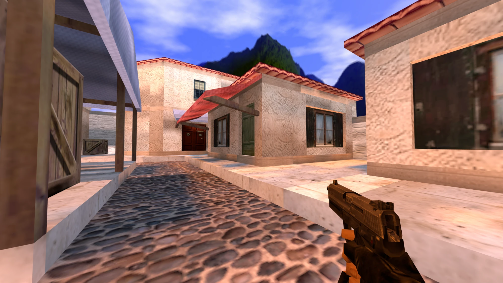
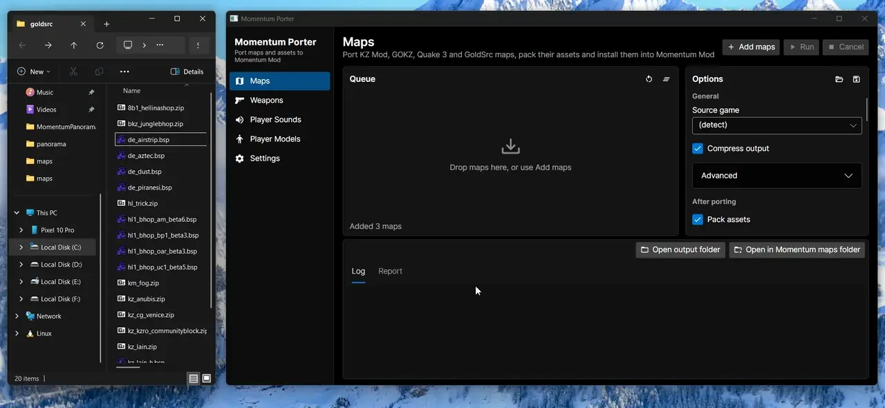
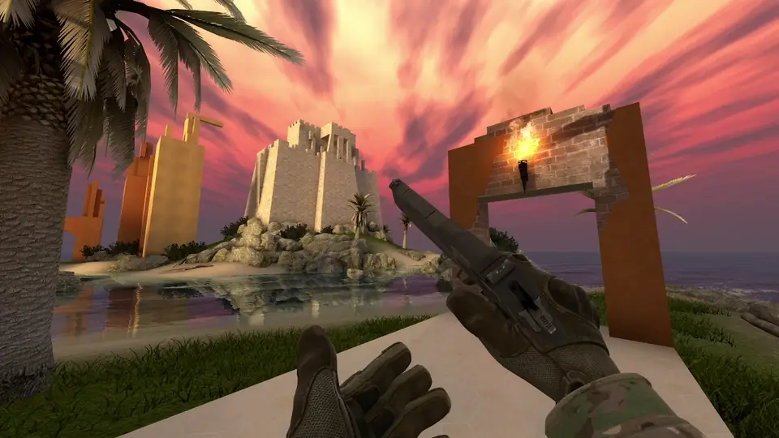
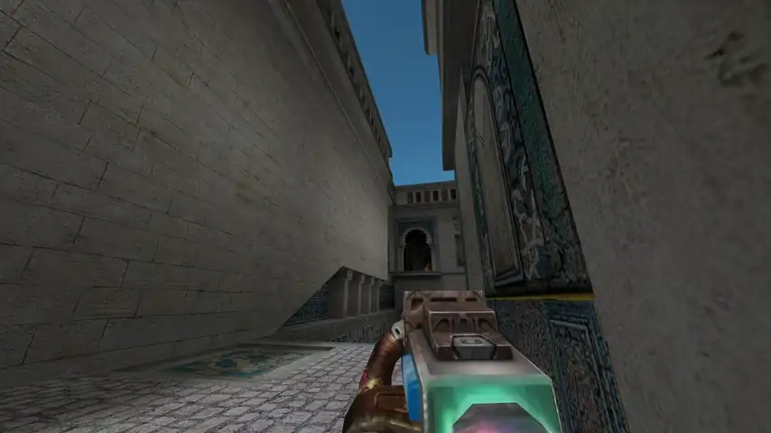
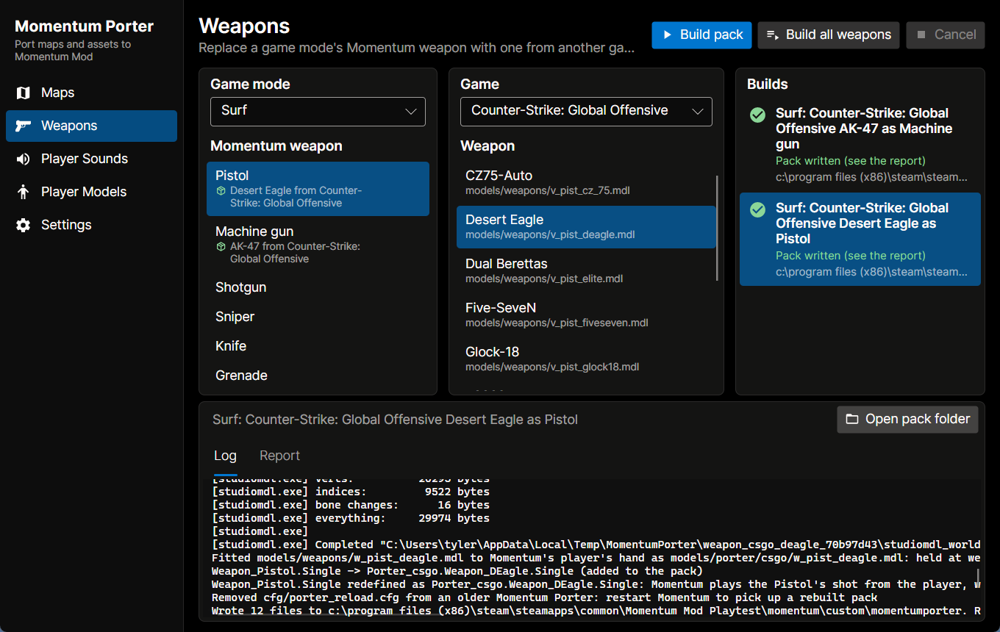
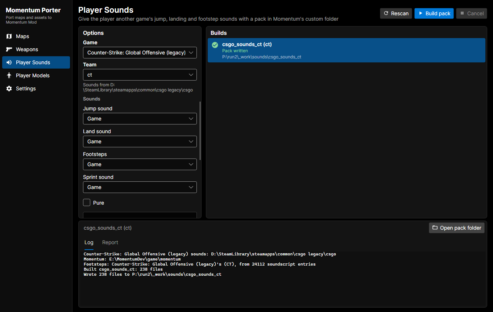

> *Momentum Mod is a standalone game built on the Source Engine, aiming to
centralize movement gametypes found in CS:S, CS:GO, and TF2.*

# Momentum Porter

Momentum Porter brings maps and assets from other games into Momentum Mod. It
converts maps, and builds packs that give Momentum another game's weapons and
player sounds, reading everything straight from your installed games.

It comes as a desktop app (`MomentumPorterUI`) and a command line
(`MomentumPorter`). Packs go into Momentum's `custom` folder and never touch the
game's own files, so deleting a pack brings Momentum's assets back.

## Features

### Map Porting

Queue up maps, pick options and run: each map is converted, its assets packed
and the map installed into Momentum.

- **Source maps** from Kreedz Climbing Mod and CS:GO (GOKZ): the game's own
  entities become Momentum's (bhop blocks, teleports, anti-bhop and
  checkpoint triggers), GOKZ's timer entities become a Momentum zone file, and
  [bspPack](https://github.com/Natanxp2/bspPack) (bundled) packs the assets
  the map needs from its game.
- **Quake 3 and GoldSrc maps** convert in process through
  [BSPConvert](https://github.com/momentum-mod/BSPConvert), with the base game
  content and WADs found automatically. GoldSrc bhop blocks become
  `func_bhop`'s.





### Weapons

Pick a game mode and one of its Momentum weapons, then the game and the weapon
that replaces it: the pack brings its view and world models, sounds, muzzle
flash and projectile. Each mode gets its own weapons, so the Climb (1.6) pistol
can be CS 1.6's USP while Climb (KZT) uses CS:GO's Desert Eagle, and **Build all
weapons** fills every weapon of a mode from one game in one go (Quake 3's whole
arsenal into Defrag).

Weapons from games Momentum mounts are used as they are; GoldSrc and Quake 3
models, textures, sounds and effects are converted. A few features need engine
changes that aren't in Momentum yet, see
[docs/engine-changes.md](docs/engine-changes.md).

<p>
  
  
</p>



### Player Sounds

Give the player another game's footsteps (per surface, as that game plays
them), jump and landing sounds, and Half-Life 2's suit sprint sound for
Accelerated Hop. Pick a Quake 3 character or a CS:GO team for their own sets.



### Player Models *(in progress)*

Other games' player bodies for ghosts, replays and third person. A prototype
fits CS:S, HL2, CS 1.6 and Half-Life models onto Momentum's skeleton so they
play Momentum's animations; it isn't in the app yet. See
[docs/player-models.md](docs/player-models.md).

## Supported Games

| Game                     | Maps | Weapons | Player sounds |
|--------------------------|:----:|:-------:|:-------------:|
| Counter-Strike: Source   |      |    ✓    |       ✓       |
| Counter-Strike: GO       | ✓ ¹  |    ✓    |       ✓       |
| Team Fortress 2          |      |    ✓    |       ✓       |
| Half-Life 2              |      |    ✓    |       ✓       |
| Counter-Strike 1.6       |  ✓   |    ✓    |       ✓       |
| Half-Life                |  ✓   |    ✓    |       ✓       |
| Quake III Arena          |  ✓   |    ✓    |       ✓       |
| Kreedz Climbing Mod      |  ✓   |         |               |

¹ Maps made with GOKZ's [mapping API](https://github.com/KZGlobalTeam/gokz/wiki/Mapping-API).

Games are found in your Steam libraries; CS:GO means the legacy (Source 1)
version Momentum mounts.

## Building

Momentum Porter is written in C# for .NET 10. BSPConvert is a submodule, so
clone with `--recursive`:

```
git clone --recursive https://github.com/Panzerhandschuh/MomentumPorter.git
cd MomentumPorter
dotnet run --project src/MomentumPorter.UI
```

The command line lives in `src/MomentumPorter.Cli`; run it with `--help`, or
see the docs for [maps](docs/maps.md), [weapons](docs/weapons.md) and
[player sounds](docs/player-sounds.md). More on the project layout and working
on BSPConvert alongside it is in [docs/building.md](docs/building.md).

## Technical Details

The solution is divided into three projects and their tests:

- __MomentumPorter.Core__ - The porting code: map conversion, the game
  profiles, weapon and sound packs. It uses
  [BSPConvert](https://github.com/momentum-mod/BSPConvert) and
  [LibBSP](https://github.com/Panzerhandschuh/LibBSP) for maps and
  [ValvePak](https://github.com/ValveResourceFormat/ValvePak) to read the games'
  VPKs.
- __MomentumPorter.UI__ - The desktop app, using
  [Avalonia](https://docs.avaloniaui.net/) and
  [ReactiveUI](https://www.reactiveui.net/) like
  [Lumper](https://github.com/momentum-mod/lumper). Its option forms are
  generated from the same option classes the command line uses.
- __MomentumPorter.Cli__ - The command line: map ports, `weapon` and `sounds`.
- __MomentumPorter.Tests__ - xunit tests. The ones that need installed games
  skip when they aren't there.

### Contributing

Bug reports and pull requests are welcome on this repository. For questions,
the [Momentum Mod Discord server](https://discord.gg/momentummod)'s `#tooling`
channel is the best place.
